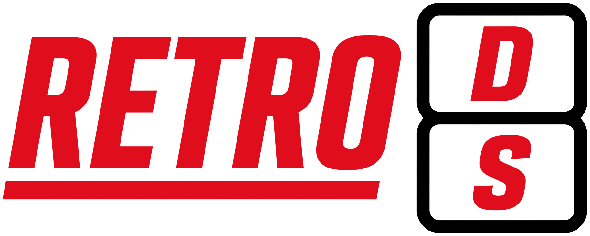
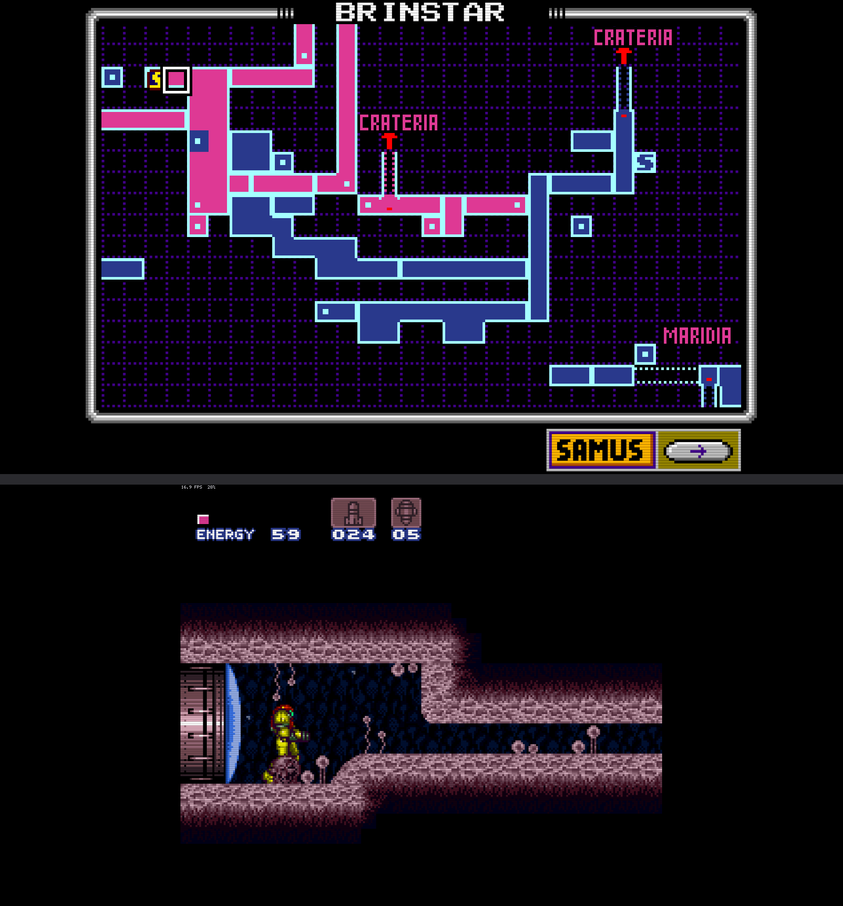
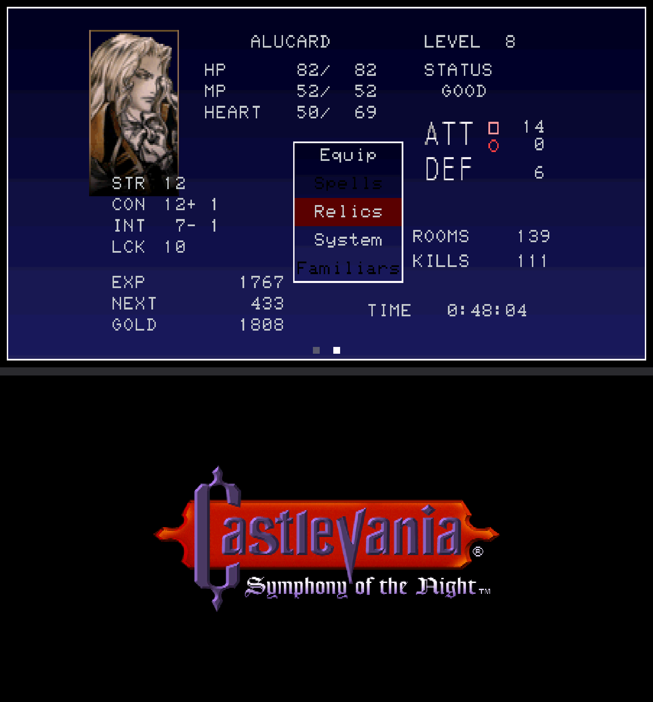
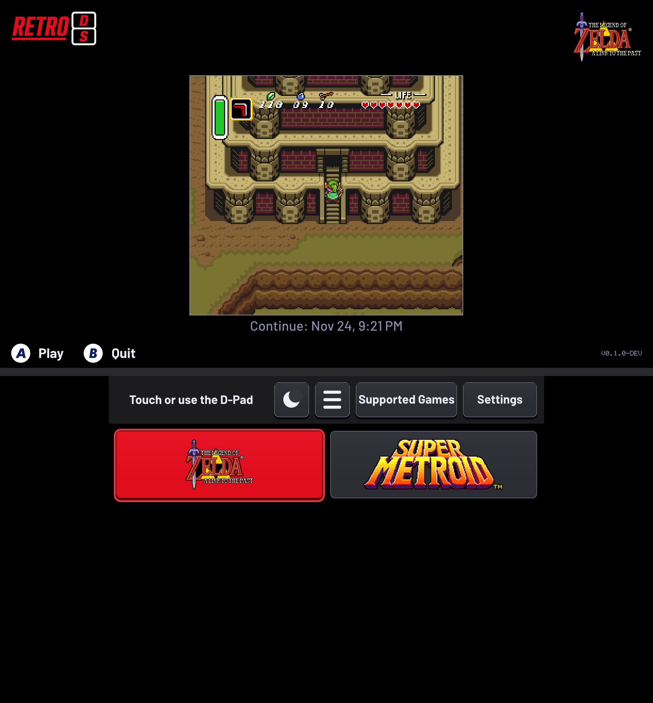
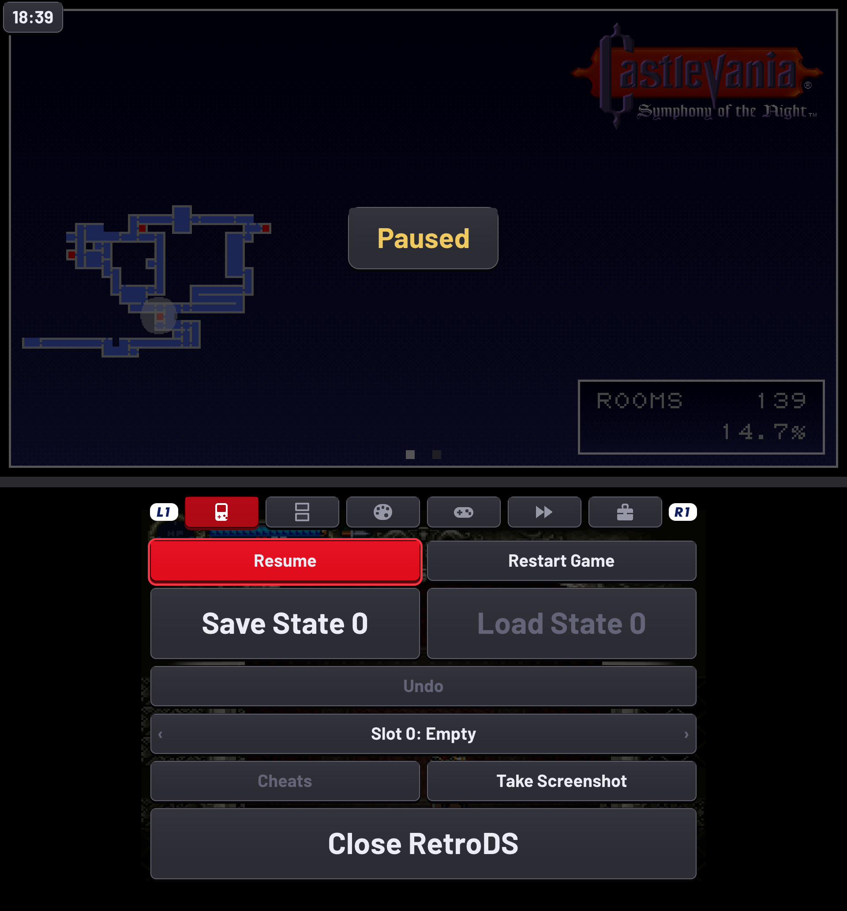

<p align="center">
  <picture>
    <source media="(prefers-color-scheme: dark)" srcset="docs/media/retrods-logo-dark.png">
    <source media="(prefers-color-scheme: light)" srcset="docs/media/retrods-logo-light.png">
    
  </picture>
</p>

<p align="center"><strong>Your favourite classics, with the second screen they never had.</strong><br>Not a Nintendo DS emulator.</p>

<p align="center">
  
  <br><sub>A Link to the Past's title: the sword falls from the second screen into the game's.</sub>
</p>

RetroDS plays Super Nintendo and PlayStation games on dual-screen Android handhelds. The game runs on one screen exactly as the console drew it. The other screen shows what the game would have put on a second screen if it had one: its map, its items, its menu, in the game's own style, live as you play.

You play with the buttons. The second screen is for looking: drag and zoom the map, tap an item to switch to it.

Built for and tested on the **Retroid Pocket Duo**; other dual-screen Android handhelds should work but haven't been tried.

# Why RetroDS

There are other ways to give these games a second screen. RetroDS takes a different one:

- **Your game, unchanged.** RetroDS runs your own cartridge or disc in an accurate emulator (bsnes, SwanStation). It isn't a port or a ROM hack: the game is the one you know, its saves are ordinary saves, and save states and cheats work as they do for any game (RetroAchievements too, on the Super Nintendo). Ports and hacks that add a second screen rebuild or change the game itself.
- **Drawn live, not captured.** GBA DS, which RetroDS grew from, fills most of its second screens by running a hidden second copy of the game and taking pictures of its screens. RetroDS reads the running game and draws the second screen itself after every frame: the map scrolls under your finger at the screen's refresh rate, with no wait for a picture and no second copy running down the battery.
- **The game's own look.** Every second screen is made from the game's own graphics (its map, its items screen, its menu), rearranged for touch at most. Nothing the game didn't already have.
- **One app for your library.** Super Nintendo and PlayStation games in one game list (with more to come!). The games RetroDS knows get their second screen.

# Games with a second screen

Each supported game gets a second screen of its own, worked out from how that game stores its data. What each one shows, and every place it changes the game, is written down in its rules page in [`docs/games/`](docs/games/).

## The Legend of Zelda: A Link to the Past

<p align="center">
  
  
  
</p>

- The world map, built from the ground the game has actually shown you, with the world map's own clouds over what you haven't seen,and the game's markers for where to go next. Pinch or tap to zoom.
- The items screen slides up over the map (X): tap an item to give it to Y.
- Drop your own markers on the map to remember a secret for later.
- In dungeons, the dungeon's own map, floor by floor.

[Rules](docs/games/a-link-to-the-past.md) · USA release

## Super Metroid

<p align="center">
  
  
</p>

- The area map as the pause screen draws it, explored rooms and all, drawn by RetroDS from the cartridge and the game's memory. Drag it and fling it; it scrolls at the screen's refresh rate.
- Tap SAMUS for the equipment page, and tap a beam, suit or item there to switch it on or off without pausing.

[Rules](docs/games/super-metroid.md) · USA / Japan release

## Castlevania: Symphony of the Night

<p align="center">
  
  
</p>

- The castle map exactly as the game's map screen draws it, read from the game's video memory. Rooms explored and the percentage of the castle are displayed.
- Windows get their colour from the game's System menu.
- Tap or pinch to zoom in on the map.

Press Start, or swipe across the second screen, and the game pauses and its own menu moves to the second screen. It is widened to fill modern devices' screens. The game screen shows the game's logo. Play the menu with the pad as usual; Start, triangle or a swipe back returns to the map.

L2 and R2 as rewind and fast forward are disabled in Symphony of the Night, due to the game itself using those buttons.

[Rules](docs/games/symphony-of-the-night.md) · USA release (SLUS-00067)

# Origins

RetroDS started as a fork of [GBA DS](https://github.com/kyannon/gba-ds), to explore what could be done with other systems. Once the Super Nintendo was running, it was clear that other systems were within easy reach, and RetroDS became its own project.

## Credits

- **[GBA DS](https://github.com/kyannon/gba-ds)** by kyannon, the Android base RetroDS is built on: the game list, the menus and settings, the two-screen Android app.
- **The emulators' developers:** [bsnes](https://github.com/bsnes-emu/bsnes) by Near (byuu) and its contributors, and its [libretro port](https://github.com/libretro/bsnes); [SwanStation](https://github.com/libretro/swanstation), libretro's fork of Stenzek's [DuckStation](https://github.com/stenzek/duckstation), and its contributors; [libretro](https://www.libretro.com), whose API lets RetroDS load them.
- **The people who took these games apart,** whose work told RetroDS where to look: P.JBoy's Super Metroid bank logs ([sm_disassembly](https://github.com/insanefirebat/sm_disassembly)), spannerisms' A Link to the Past disassembly ([usdasm](https://github.com/spannerisms/usdasm)), snesrev's [zelda3](https://github.com/snesrev/zelda3), and the [sotn-decomp](https://github.com/Xeeynamo/sotn-decomp) project (Xeeynamo and contributors). Used as references for addresses and formats only: no code from them.
- **[RetroAchievements](https://retroachievements.org)** and its rcheevos library.


## Every other game

Any other Super Nintendo or PlayStation game plays on one screen, with its title logo or name on the other. So do other regional releases of the games above. You can play other SNES or PSX games in BSNES or Swanstation here but it is single-screen only.

# Systems

| System | Emulator | Games | ROM folder | BIOS |
|---|---|---|---|---|
| Super Nintendo | [bsnes](https://github.com/libretro/bsnes) | `.sfc` `.smc` `.swc` `.fig` `.zip` | `ROMs/snes` | not needed |
| PlayStation | [SwanStation](https://github.com/libretro/swanstation) | `.cue` with its `.bin` tracks | `ROMs/psx` | your own, required: `scph5501.bin` for US games |

## Getting started (Android)

1. Install the APK. There are no releases yet: each change is built by GitHub Actions, and the APK is the **Android** workflow run's artifact. Allow RetroDS **All files access** when it asks, so your saves and states live in shared storage.
2. Put your own games, and for the PlayStation your own BIOS, here:

```text
/storage/emulated/0/
├── ROMs/
│   ├── snes/        Super Nintendo games (battery saves go beside them, .srm)
│   └── psx/         PlayStation discs, .cue + .bin (memory card saves beside them, .srm)
└── RetroDS/
    ├── bios/        scph5501.bin (never included)
    ├── states/      save states, settings for each game, logos
    ├── logos/       your own logos for the game list and second screen (optional)
    ├── overlays/    your own overlays (optional)
    └── cheats/
```

3. Open RetroDS, pick a game. Tap the game screen or press HOME for RetroDS's menu: save and load states (with Undo), screens and scaling (4:3 or Pixel Perfect), shaders, controls, and the rest.

<p align="center">
  
  
</p>

Also there: cheats; and on the Super Nintendo, rewind (L2), fast forward (R2), patches applied as the game loads (IPS, UPS, BPS, xdelta) and RetroAchievements (casual mode); ten languages.

# How it works

The emulators are [libretro](https://www.libretro.com) cores, loaded as libraries, with small patches that let RetroDS read the game's memory and video memory ([`scripts/cores/`](scripts/cores/)).

- **Drawn from the game itself.** After every frame RetroDS reads the running game and draws the second screen from the game's own graphics and data:
  - Super Metroid's map and SAMUS page from the cartridge's map data and the game's memory.
  - A Link to the Past's world from the ground the game has shown you; its items screen and dungeon maps from the game's own tiles and memory.
  - Symphony of the Night's castle map from the map the game keeps in video memory; its menu is the game's own, moved to the second screen.
  - Nothing runs hidden, and RetroDS ships no game graphics: they come from your copy.
- **The game's own look.** No RetroDS panels or icons on the second screen: the game's screens, rearranged for touch at most. The full statement is [Philosophy](wiki/Philosophy.md).
- **Writes are rare and listed.** Looking changes nothing. Where a tap changes the game (switching an item), RetroDS writes what the game's own menu would, through one gate that only takes the addresses the game's rules page lists, between frames, all or nothing, logged. Symphony of the Night is never written to: RetroDS only presses its buttons.
- **Rules first, checked against the game.** A second screen is written down in its rules page before it's built, and checked pixel for pixel against the game's own screens ([`scripts/check-games.sh`](scripts/check-games.sh)).

## Building

Android (arm64) and the Linux desktop, which is used for development and testing.

```sh
scripts/setup-host.sh      # SDL2, bsnes and SwanStation, the app and the test harness
make && make tools         # build/host/retrods, build/host/retrods-harness
scripts/check-games.sh --alttp ZELDA.sfc --sm METROID.smc   # the second screens' checks
```

The Android APK is built by `scripts/build-android.sh` on GitHub Actions ([`.github/workflows/android.yml`](.github/workflows/android.yml)). The harness (`tools/retrods-harness.c`) drives the cores from a script: button presses, states, memory, pictures. [`CLAUDE.md`](CLAUDE.md) has the development notes.

## Not affiliated

RetroDS is an independent fan project, not affiliated with, endorsed by or sponsored by Nintendo, Sony Interactive Entertainment, Konami, Retroid, the GBA DS project, or any company whose games or hardware it runs on or mentions. All trademarks belong to their owners. RetroDS includes no games, BIOS files or game graphics; the pictures on this page are of RetroDS running the owner's own copies.

## Licence

GPLv3 only ([LICENSE](LICENSE)), as GBA DS. Third-party parts keep their own licences:

- bsnes, with RetroDS's memory patch: GPLv3
- SwanStation, with RetroDS's video memory patch: GPLv3 (its sources GPLv2 or later; what it bundles is listed in the APK's licence notices)
- SDL2: zlib licence
- rcheevos (`third_party/rcheevos`): MIT
- libwebp (`third_party/libwebp`): BSD 3-clause
- Barlow and Noto Sans JP / KR / SC / TC subsets (`assets/fonts/`): SIL Open Font License 1.1
- stb headers (`src/stb_*.h`): public domain or MIT
- the libretro API header (`src/libretro.h`): MIT
