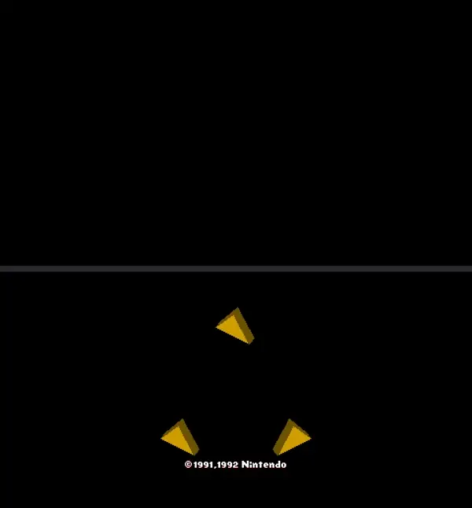
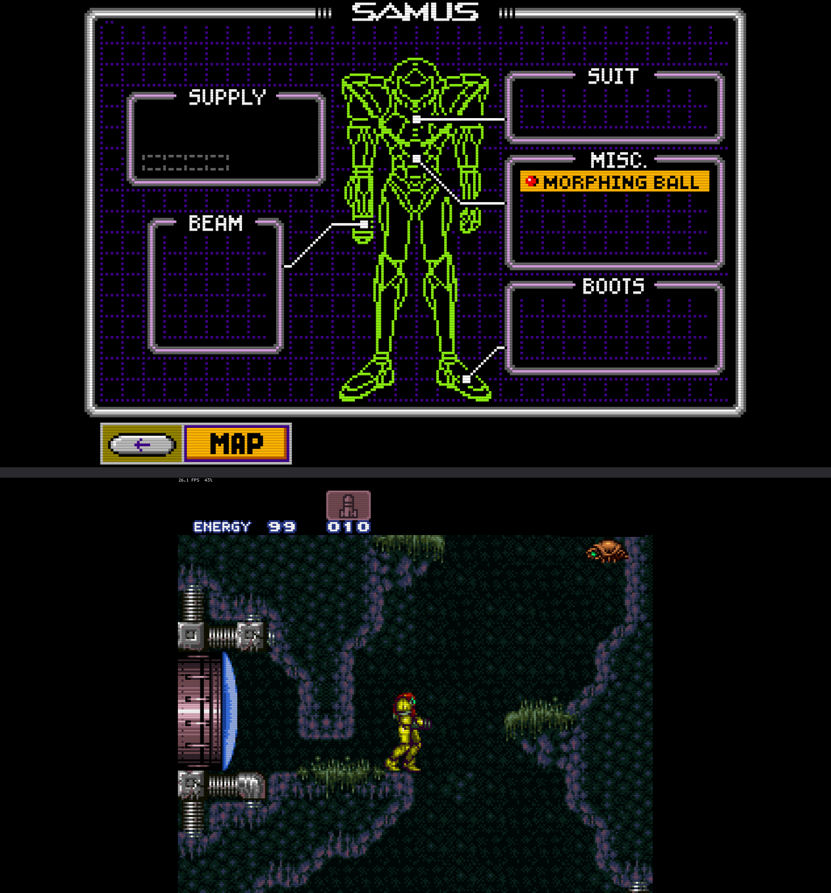
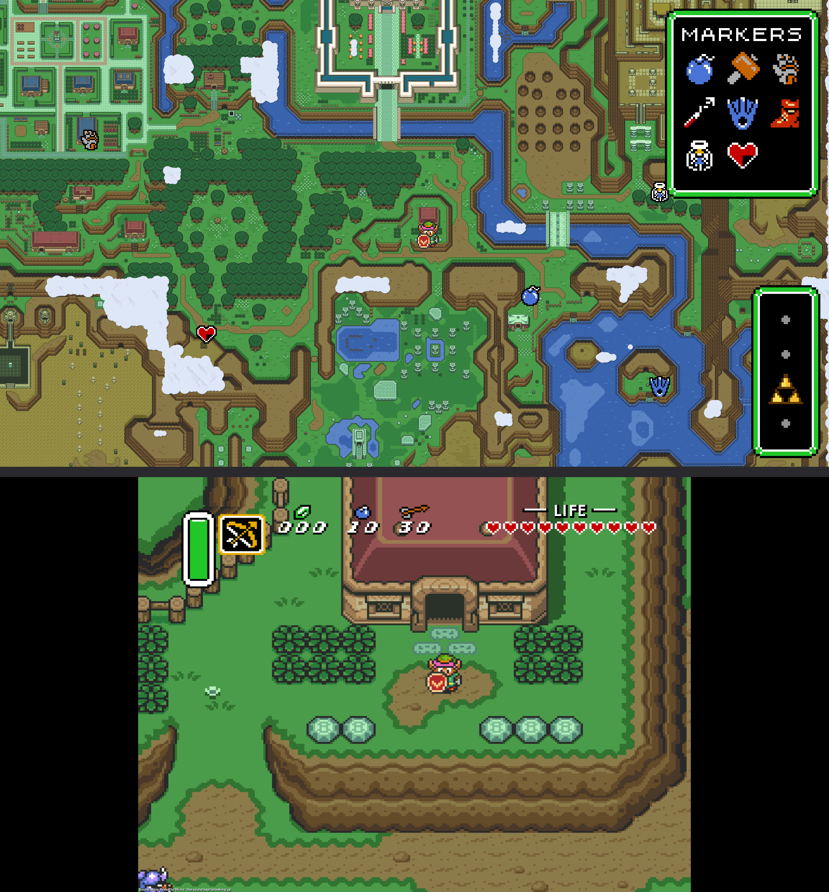
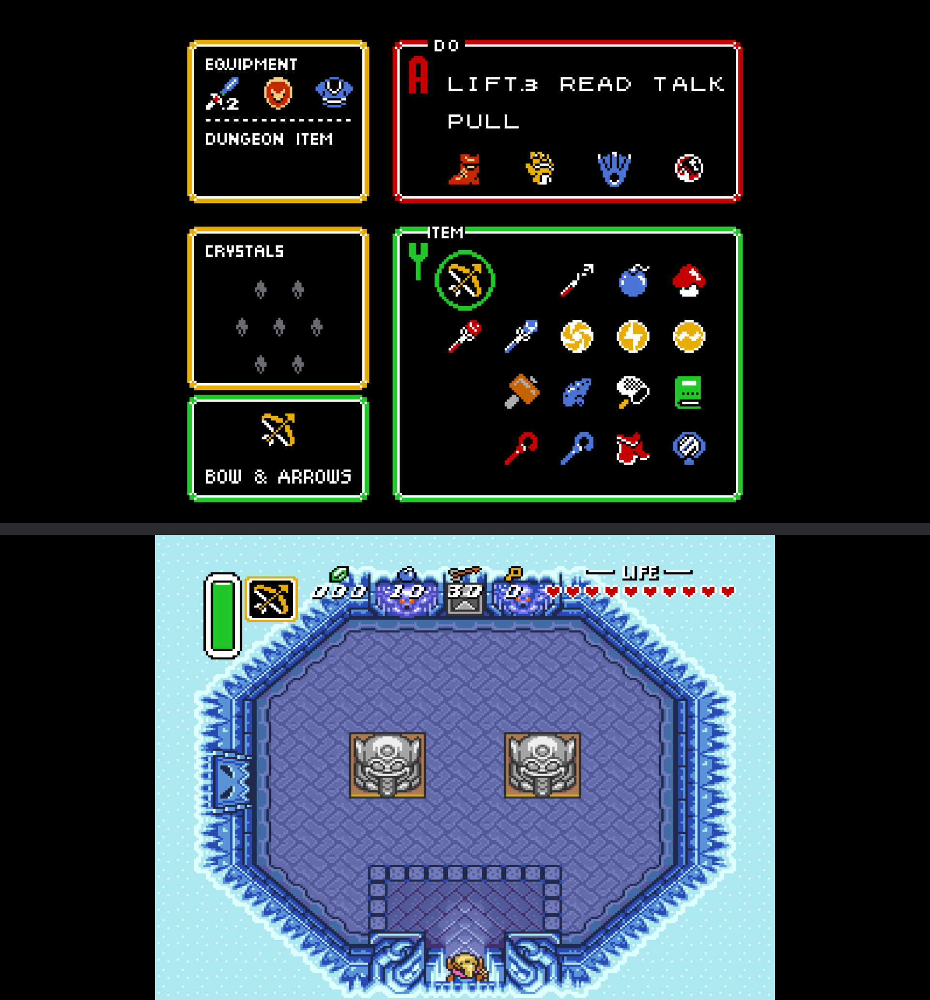
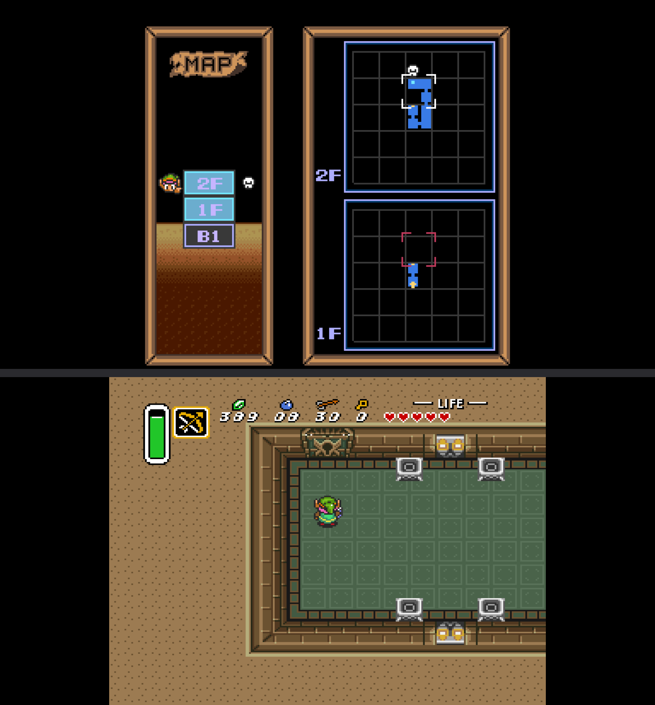
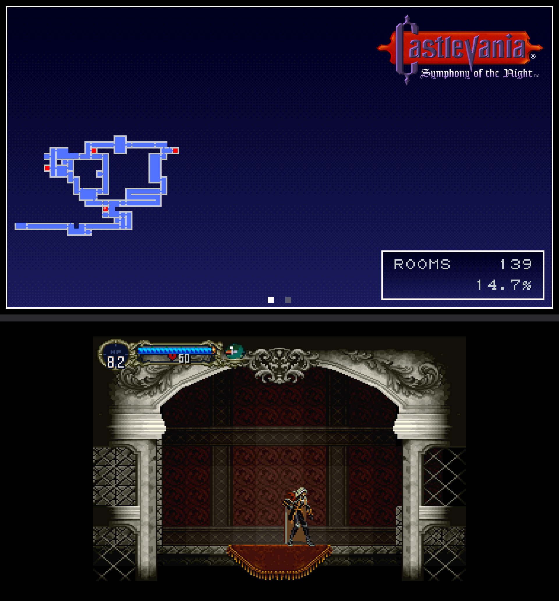

<p align="center">
  <picture>
    <source media="(prefers-color-scheme: dark)" srcset="docs/media/retrods-logo-dark.png">
    <source media="(prefers-color-scheme: light)" srcset="docs/media/retrods-logo-light.png">
    
  </picture>
</p>

<p align="center"><strong>Your favourite classics, with the second screen they never had.</strong><br>Not a Nintendo DS emulator.</p>

<p align="center">
  
  <br><sub>A Link to the Past's title on a Retroid Pocket Duo: the sword falls from the second screen into the game's.</sub>
</p>

RetroDS plays Super Nintendo and PlayStation games on dual-screen Android handhelds. The game runs on one screen exactly as the console drew it. The other screen shows what the game would have put on a second screen if it had one: its map, its items, its menu, in the game's own style, live as you play.

You play with the buttons. The second screen is for looking: drag and zoom the map, tap an item to switch to it.

It's built for and tested on the **Retroid Pocket Duo**. Other dual-screen Android handhelds should work but haven't been tried: the game goes on whichever screen fits a 4:3 picture best, and the other gets the second screen.

> RetroDS doesn't play Nintendo DS games.

## Games with a second screen

Each supported game gets a second screen of its own, worked out from how that game stores its data. What each one shows, and every place it changes the game, is written down in its rules page in [`docs/games/`](docs/games/).

### Super Metroid

<p align="center">
  
  
</p>

- The area map as the pause screen draws it, explored rooms and all, drawn by RetroDS from the cartridge and the game's memory. Drag it and fling it; it scrolls at the screen's refresh rate.
- Tap SAMUS for the equipment page, and tap a beam, suit or item there to switch it on or off without pausing.
- The mini-map on the game screen is covered while the full map is on the other screen.

[Rules](docs/games/super-metroid.md) · USA / Japan release

### The Legend of Zelda: A Link to the Past

<p align="center">
  
  
  
</p>

- The world map, built from the ground the game has actually shown you, with the world map's own clouds over what you haven't seen, Link walking on it, and the game's markers for where to go next. Pinch or tap to zoom.
- The items screen slides up over the map (X): tap an item to give it to Y. Drop your own markers on the map to remember a secret for later.
- In dungeons, the dungeon's own map, floor by floor.

[Rules](docs/games/a-link-to-the-past.md) · USA release

### Castlevania: Symphony of the Night

<p align="center">
  
  
</p>

- The castle map exactly as the game's map screen draws it, read from the game's video memory, in its status-screen window (your window colour from the game's System menu), with the game's own cursor on Alucard's room, the rooms explored and the percentage. Tap or pinch to zoom in.
- Press Start, or swipe across the second screen, and the game pauses and its own menu moves to the second screen, widened to fill it, while the game screen shows the logo. Play the menu with the pad as usual; Start or a swipe back carries on.
- L2 and R2 go to the game (rewind and fast forward are the Super Nintendo's).

[Rules](docs/games/symphony-of-the-night.md) · USA release (SLUS-00067)

### Every other game

Any other Super Nintendo or PlayStation game plays on one screen, with its title logo or name on the other. So do other regional releases of the games above, for now: each rules page lists the exact releases it knows.

## Systems

| System | Emulator | Games | ROM folder | BIOS |
|---|---|---|---|---|
| Super Nintendo | [bsnes](https://github.com/libretro/bsnes) | `.sfc` `.smc` `.swc` `.fig` `.zip` | `ROMs/snes` | not needed |
| PlayStation | [SwanStation](https://github.com/libretro/swanstation) | `.cue` with its `.bin` tracks | `ROMs/psx` | your own, required: `scph5501.bin` for US games |

## Getting started (Android)

1. Install the APK. There are no releases yet: each change is built by GitHub Actions, and the APK is the **Android** workflow run's artifact. Allow RetroDS **All files access** when it asks, so your saves and states live in shared storage.
2. Put your own games, and for the PlayStation your own BIOS, here:

```text
/storage/emulated/0/
├── ROMs/
│   ├── snes/        Super Nintendo games (battery saves go beside them, .srm)
│   └── psx/         PlayStation discs, .cue + .bin (memory card saves beside them, .srm)
└── RetroDS/
    ├── bios/        scph5501.bin (never included)
    ├── states/      save states, settings for each game, logos
    ├── logos/       your own logos for the game list and second screen (optional)
    ├── overlays/    your own overlays (optional)
    └── cheats/
```

3. Open RetroDS, pick a game. Tap the game screen or press HOME for RetroDS's menu: save and load states (with Undo), screens and scaling (4:3 or Pixel Perfect), shaders, controls, and the rest.

<p align="center">
  
  
</p>

Also there: rewind (L2) and fast forward (R2) on the Super Nintendo, patches applied as the game loads (IPS, UPS, BPS, xdelta), cheats, RetroAchievements (casual mode), and ten languages.

**Coming from SNES DS?** RetroDS is a new app beside it. On its first start it copies your `SNES DS/` states, settings, cheats, logos and overlays into `RetroDS/`, leaving the originals; keep SNES DS until you've seen your states in RetroDS.

## How it works

The emulators are [libretro](https://www.libretro.com) cores, loaded as libraries, with small patches that let RetroDS read the game's memory and video memory ([`scripts/cores/`](scripts/cores/)).

- **Drawn from the game itself.** After every frame RetroDS reads the running game and draws the second screen from the game's own graphics and data: Super Metroid's map from the cartridge's map data, A Link to the Past's world from the ground it has shown, Symphony of the Night's from the map it keeps in video memory. Nothing runs hidden, and RetroDS ships no game graphics: they come from your copy.
- **The game's own look.** No RetroDS panels or icons on the second screen: the game's screens, rearranged for touch at most. The full statement is [Philosophy](wiki/Philosophy.md).
- **Writes are rare and listed.** Looking changes nothing. Where a tap changes the game (switching an item), RetroDS writes what the game's own menu would, through one gate that only takes the addresses the game's rules page lists, between frames, all or nothing, logged. Symphony of the Night is never written to: RetroDS only presses its buttons.
- **Rules first, checked against the game.** A second screen is written down in its rules page before it's built, and checked pixel for pixel against the game's own screens ([`scripts/check-games.sh`](scripts/check-games.sh)).

## Building

Android (arm64) and the Linux desktop, which is used for development and testing.

```sh
scripts/setup-host.sh      # SDL2, bsnes and SwanStation, the app and the test harness
make && make tools         # build/host/retrods, build/host/retrods-harness
scripts/check-games.sh --alttp ZELDA.sfc --sm METROID.smc   # the second screens' checks
```

The Android APK is built by `scripts/build-android.sh` on GitHub Actions ([`.github/workflows/android.yml`](.github/workflows/android.yml)). The harness (`tools/retrods-harness.c`) drives the cores from a script: button presses, states, memory, pictures. [`CLAUDE.md`](CLAUDE.md) has the development notes.

## Origins

RetroDS was called SNES DS until November 2026, and began as a fork of [GBA DS](https://github.com/kyannon/gba-ds) by kyannon, which does the same for the Game Boy Advance. The game list, the menus, settings and the Android app grew from GBA DS's; the emulators, the second screens and the look are RetroDS's. For Game Boy Advance games, use GBA DS.

## AI disclosure

RetroDS is written almost entirely by AI: its code, documentation and commit messages are written by Claude (Anthropic) in Claude Code sessions. Its owner decides what's built and how each game's second screen should look and behave, reviews each game's rules before they're built, and tests every change on the device. GBA DS was made the same way. The RetroDS logo and icon are the owner's. The emulators themselves, bsnes and SwanStation, are long-established, human-written projects.

## Not affiliated

RetroDS is an independent fan project, not affiliated with, endorsed by or sponsored by Nintendo, Sony Interactive Entertainment, Konami, Retroid, the GBA DS project, or any company whose games or hardware it runs on or mentions. All trademarks belong to their owners. RetroDS includes no games, BIOS files or game graphics; the pictures on this page are of RetroDS running the owner's own copies.

## Licence

GPLv3 only ([LICENSE](LICENSE)), as GBA DS. Third-party parts keep their own licences:

- bsnes, with RetroDS's memory patch: GPLv3
- SwanStation, with RetroDS's video memory patch: GPLv3 (its sources GPLv2 or later; what it bundles is listed in the APK's licence notices)
- SDL2: zlib licence
- rcheevos (`third_party/rcheevos`): MIT
- libwebp (`third_party/libwebp`): BSD 3-clause
- Barlow and Noto Sans JP / KR / SC / TC subsets (`assets/fonts/`): SIL Open Font License 1.1
- stb headers (`src/stb_*.h`): public domain or MIT
- the libretro API header (`src/libretro.h`): MIT
